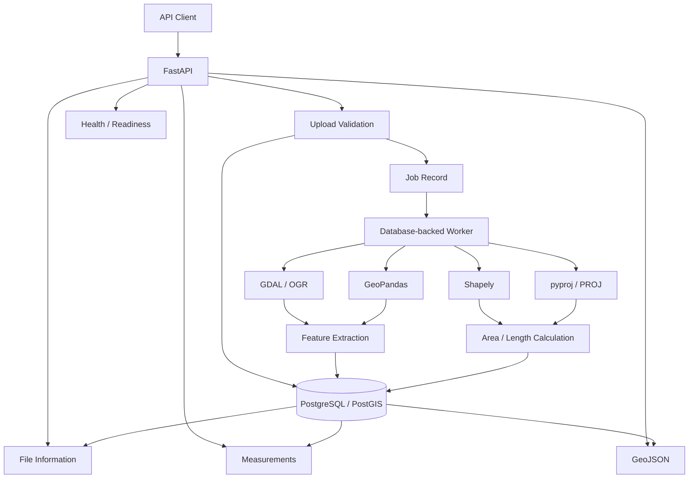

# Geospatial File Measurement API

A production-oriented backend that accepts KML files or Shapefile ZIP archives, extracts their features, calculates metric area/length safely, tracks processing status, and exposes paginated measurement results.

## Why this design

The assignment requires KML/Shapefile upload, feature extraction, geometry type/CRS/properties handling, polygon area, LineString length, graceful handling of unsupported geometries, and projection before measuring geographic coordinates.

This implementation goes beyond the minimum with:

- asynchronous database-backed job processing
- safe streaming uploads
- ZIP path traversal and archive-size protection
- per-feature failure isolation
- feature-level measurement CRS selection
- pagination
- GeoJSON output for interoperability and visualization
- request IDs for traceability
- Docker + PostgreSQL/PostGIS deployment
- tests for calculations, API behavior, malformed input, and ZIP safety

## Stack

- Python 3.12+
- FastAPI
- SQLAlchemy 2
- GeoPandas, Shapely, pyproj, GDAL/OGR, pyogrio
- Database-backed worker using PostgreSQL row locking
- Docker / Docker Compose
- Production-style: PostgreSQL + PostGIS + independent workers
- Development: SQLite + embedded worker

## Project architecture



## Run with Docker

```bash
docker compose up --build
```

API: `http://localhost:8000`

Swagger UI: `http://localhost:8000/docs`

No third-party external API is used by the application. The geospatial calculations and file parsing are local.

## Run locally without Docker

Create a virtual environment and install:

```bash
python -m venv .venv
# Windows CMD
.venv\\Scripts\\activate
# Windows PowerShell
# .venv\\Scripts\\Activate.ps1
# Linux/macOS
# source .venv/bin/activate

pip install -r requirements.txt
```

Copy `.env.example` to `.env`.

The default local database is SQLite. For the easiest local run, keep:

```env
DATABASE_URL=sqlite:///./geospatial.db
EMBEDDED_WORKER=true
```

Then run:

```bash
uvicorn app.main:app --reload
```

## Production-style worker mode

For PostgreSQL, set `EMBEDDED_WORKER=false`. Docker Compose runs a one-time database initialization container before the API and worker start. You can also run the worker manually with:

```bash
python -m app.worker
```

Multiple workers can safely share the same PostgreSQL job queue. Jobs are claimed with row-level locking and `SKIP LOCKED`.

## API

### Upload

`POST /api/files/`

Multipart form field: `file`

Supported inputs:

- `.kml`
- `.zip` containing exactly one Shapefile (`.shp`, `.shx`, `.dbf`; `.prj` recommended)

Returns HTTP 202:

```json
{
  "id": "...",
  "filename": "survey.kml",
  "status": "QUEUED",
  "message": "File accepted for processing."
}
```

### File information

`GET /api/files/{id}/`

Example response:

```json
{
  "id": "...",
  "filename": "survey.kml",
  "source_type": "kml",
  "feature_count": 120,
  "crs": "EPSG:4326",
  "status": "COMPLETED",
  "source_size_bytes": 12345,
  "processed_features": 120,
  "successful_measurements": 90,
  "failed_features": 0,
  "error_message": null,
  "created_at": "...",
  "updated_at": "...",
  "processed_at": "..."
}
```

### Measurements

`GET /api/files/{id}/measurements/?page=1&page_size=100&include_geometry=false`

Measurements are returned per feature. Polygon/MultiPolygon values are area in `m²`; LineString/MultiLineString values are length in `m`.

### GeoJSON

`GET /api/files/{id}/geojson/?page=1&page_size=100`

Returns a GeoJSON `FeatureCollection`, useful for rendering the processed geometry in a frontend without a third-party map API.

### Health

- `GET /health`
- `GET /ready`

## CRS strategy

For geographic CRS inputs (for example EPSG:4326), the service does not measure directly in degrees.

For each measurable feature, it tries to select the feature's local UTM CRS using GeoPandas. If UTM estimation is unavailable (for example near/over UTM limits), it falls back to a feature-centered Lambert Azimuthal Equal Area projected CRS. Measurements are therefore produced in meters/meters-squared rather than degree units.

For already-projected CRS inputs, calculations use the supplied projected CRS.

If a measurable geometry has no CRS, the feature is marked `MISSING_CRS` instead of producing an unsafe measurement.

## Job states

- `QUEUED`
- `PROCESSING`
- `COMPLETED`
- `COMPLETED_WITH_ERRORS`
- `FAILED`

An unsupported or invalid feature does not stop the remaining valid features.

## Tests

```bash
pytest -q
```
### Tests cover:
- KML processing
- Shapefile ZIP processing
- Polygon area
- LineString length
- Point handling
- CRS transformation
- invalid file types
- corrupt ZIP archives
- invalid Shapefile archives
- ZIP path traversal protection
- health/readiness endpoints


## Learning and future scope

The project demonstrates API design, secure file handling, geospatial data processing, CRS-aware measurements, asynchronous job execution, relational persistence, testing, and containerized deployment.

Future work could add authentication/authorization, object storage, result exports, configurable measurement units, spatial analytics, distributed worker autoscaling, and an optional self-hosted vector-tile map service.
